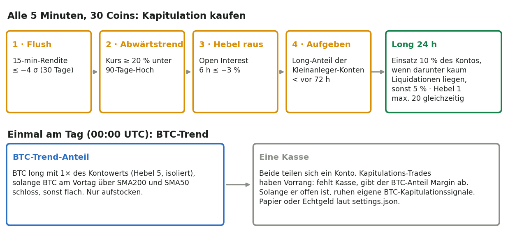
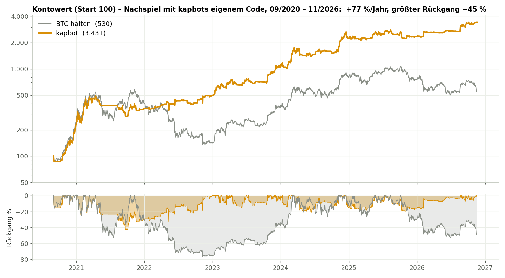
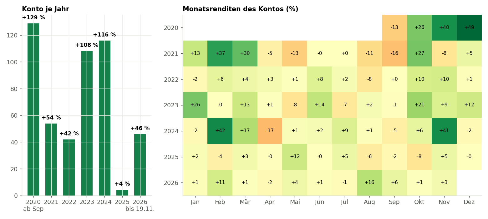
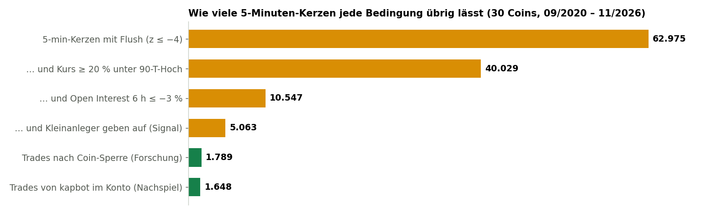
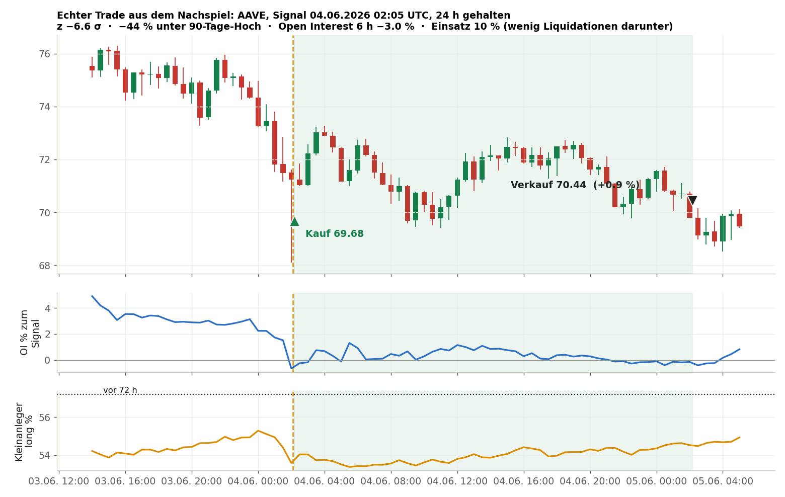

# kapbot

Eigener Bot, unabhängig vom evobot. Zwei Bausteine aus **einer Kasse** auf Bitget USDT-Futures, Lauf alle 5 Minuten:

1. **BTC-Trend:** BTC long mit 1× des Kontowerts (Hebel 5, isolierte Margin), solange BTC am Vortag über SMA200 **und** SMA50 schloss, sonst flach.
2. **Kapitulation kaufen** (30 Coins): Long für 24 h, wenn in einer geschlossenen 5-Minuten-Kerze **alle vier** Bedingungen gelten:
   - Flush: 15-min-Rendite ≤ −4 σ (σ = Schwankung der letzten 30 Tage)
   - Abwärtstrend: Kurs ≥ 20 % unter dem 90-Tage-Hoch
   - Hebel rausgespült: Open Interest in 6 h um ≥ 3 % gefallen
   - Kleinanleger geben auf: Anteil der Konten long ist kleiner als vor 72 h

   Einsatz 10 % des Kontos, wenn unter dem Kurs kaum noch Liquidationen liegen (Modell-Karte aus 90 Tagen Open Interest), sonst 5 %; Hebel 1, höchstens 20 gleichzeitig.
   Kapitulations-Trades haben Vorrang: Fehlt Kasse, gibt der BTC-Anteil Margin ab. Solange der BTC-Anteil offen ist, ruhen eigene BTC-Kapitulationssignale.



## Ergebnisse (01.09.2020 – 19.11.2026, mit kapbots eigenem Code nachgespielt, Kontobewertung stündlich)

| | Ende (Start 100) | pro Jahr | größter Rückgang |
|---|---|---|---|
| **kapbot (BTC-Trend + Kapitulation)** | **3.431** | **+77 %** | **−45 %** |
| davon 2024–2026 (Prüfzeitraum) | | +51 % | −32 % |
| BTC halten (gleicher Zeitraum) | 530 | +31 % | −77 % |



Beide Hälften sind positiv (9/2020–9/2023: +89 %/J, 10/2023–11/2026: +65 %/J). Im Nachspiel: 1.648 Kapitulations-Trades
(732 mit 10 %, 916 mit 5 % Einsatz), 73 Buchungen des BTC-Trend-Anteils, keine Liquidation.



### Wie selten das Signal ist

Von knapp 63.000 Flush-Kerzen bleiben nach allen vier Bedingungen 5.063 übrig; die Coin-Sperre (24 h je Coin) macht daraus 1.789
Forschungs-Trades, im Konto handelt kapbot davon 1.648 (der Rest fällt in Momente ohne freies Kapital bzw. mit BTC-Anteil auf BTC).



### Ein typischer Trade

Ein echter Trade aus dem Nachspiel mit einem Ergebnis nahe am Median (gelb gestrichelt = Signalkerze, grün = 24 h Haltedauer):
Kurs fällt im Flush, Open Interest bricht weg, der Long-Anteil der Kleinanleger sinkt unter den Wert von vor 72 h.



Die Regel wurde präregistriert gesucht und auf Daten geprüft, die bei der Auswahl nicht verwendet wurden: 2024–26 (+1,80 %/Trade),
5 + 10 + 10 + 30 neue Coins (+1,01 / +1,44 / +1,65 / +1,28 %/Trade), die Trend-Regel außerhalb der Stichprobe (BTC 2018–20, ETH 2020–26).
Forschung, Präregistrierungen und Skripte: `botprojekte/forschung/2026-11-20-btc-abverkaeufe/`.

**Nachspiel:** `tools/nachspiel.py` führt die Bot-Funktionen selbst (`pruefbar`, `kauf`, `exits`, `trend` → `btc_trend.step`/`free_margin`, `markt.Konto`) Ereignis für Ereignis auf den historischen Binance-Daten aus; ersetzt werden nur die Datenquellen. Jeder Bot-Trade ist ein Forschungssignal (1.648 von 1.789; die übrigen fallen in Momente ohne freies Kapital bzw. mit BTC-Anteil auf BTC). Unterschiede zu live: Kurse von Binance statt Bitget, Funding des BTC-Anteils im Papier pauschal 10 %/J (wie der Bot bucht).

## Schalter (`settings.json`)

| Schalter | Standard | Wirkung |
|---|---|---|
| `echtgeld.aktiv` · `papier_startkapital` | **aus** · 100 | wie beim jaegerbot: aus = Papierhandel mit echten Bitget-Kursen (Konto `data/papier/konto.json`, Telegram „📝 PAPIER“), an = echte Orders über `secret.json` → `kapbot` (Konto `data/echtgeld`). Je Lauf neu gelesen, Wechsel wird gemeldet, offene Positionen des anderen Modus schließen trotzdem regulär. `update.sh` behält deine Einstellung. |
| `kapbot.aktiv` · `einsatz` · `einsatz_viel_liq` · `hebel` · `max_offen` | an · 0,10 · 0,05 · 1 · 20 | Kapitulation kaufen; aus = keine neuen Trades, offene laufen aus |
| `btc_trend.aktiv` · `faktor` · `hebel` | an · 1,0 · 5 | BTC-Trend-Anteil; aus = Anteil wird geschlossen |

## `secret.json` (nicht im Git)

```json
{
  "kapbot": [{"apiKey": "...", "secret": "...", "password": "..."}],
  "telegram": {"bot_token": "...", "chat_id": "..."}
}
```
Für Papier reicht `telegram`. Für Echtgeld ein Bitget-Zugang – am besten ein eigenes Unterkonto, wenn andere Bots dieselben Coins handeln
(sonst mischen sich Positionen desselben Symbols mit anderem Hebel).

## Installation auf dem Mini-PC

```sh
git clone <repo> ~/botprojekte/kapbot && cd ~/botprojekte/kapbot
./install.sh            # .venv, Dienst kapbot.timer (alle 5 min, 1 min nach Kerzenschluss)
sudo systemctl start kapbot.service ; journalctl -u kapbot -n 40
```
Erster Lauf lädt 90 Tage 5m-Kerzen und Open Interest für 30 Coins (≈ 10–15 min, ≈ 15 MB in `data/`), danach wenige Sekunden je Lauf.
Bericht: `.venv/bin/python -m kapbot bericht` · Update: `./update.sh`.

## Cockpit

`cockpit.json` meldet das Papierkonto (`data/papier/konto.json`, Format wie evobot, Takt 5 min, ohne SL). Im Echtgeldmodus nutzt das Cockpit den
Schlüssel `secret.json` → `kapbot`.

## Prüfungen

- `python -m unittest discover -s tests` (offline, keine Netz- oder Order-Aufrufe)
- `python tools/parity_signale.py` – Live-Regel gegen alle 1.789 Forschungssignale (exakt)
- `python tools/parity_ll3.py` – Liquidationskarte (90 Tage) gegen die Forschung (98,4 % gleiche Einstufung)
- `python tools/nachspiel.py` – Konto 2020–2026 mit dem Bot-Code (Ergebnis oben)
- `python tools/readme_grafiken.py` – erzeugt die Bilder in `docs/images/` aus dem Nachspiel (Desktop, braucht pandas + matplotlib)
